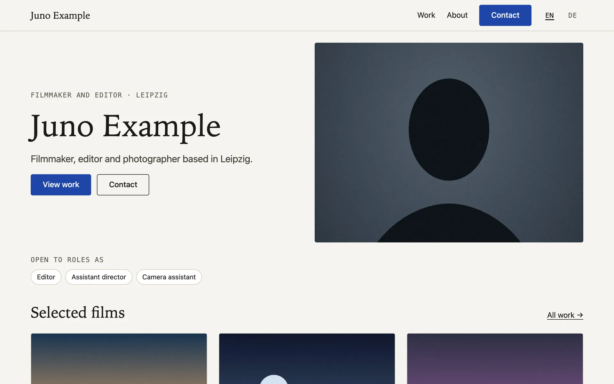
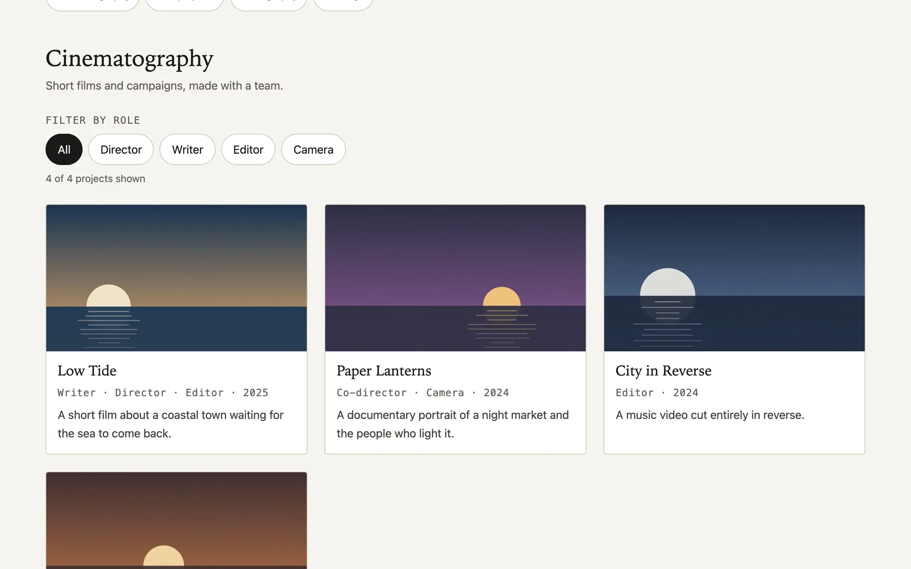
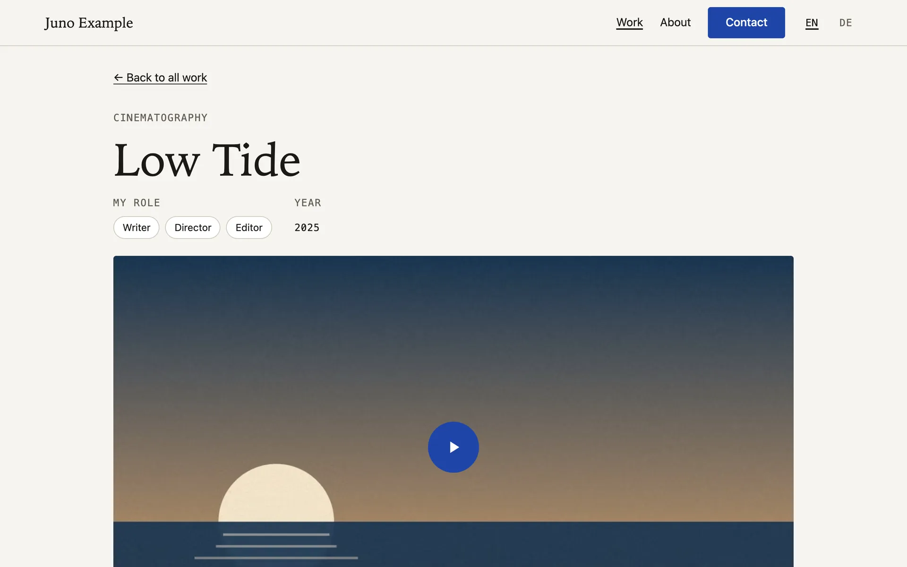
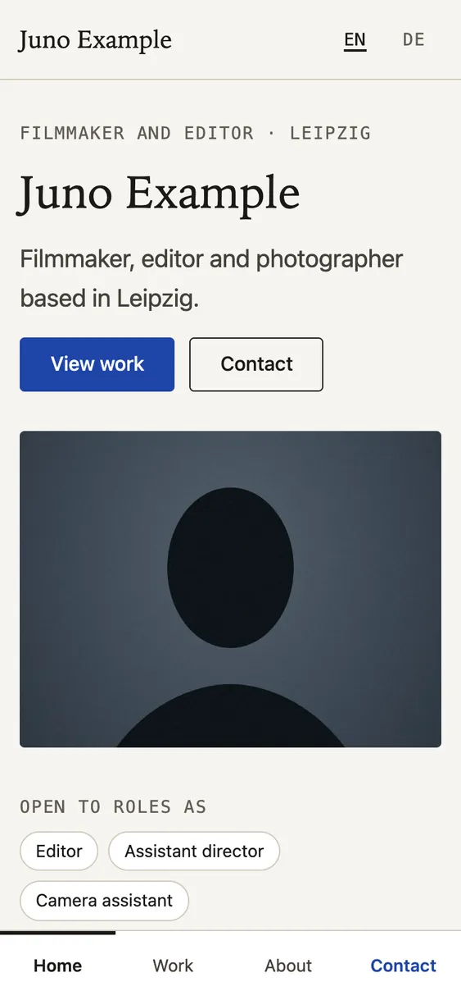
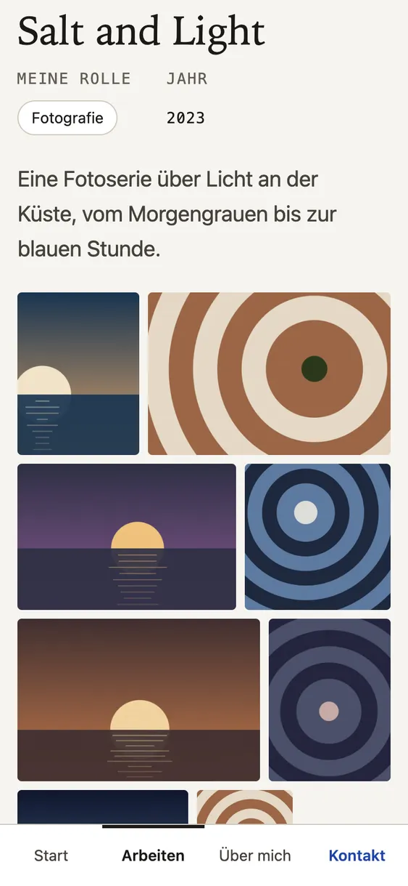
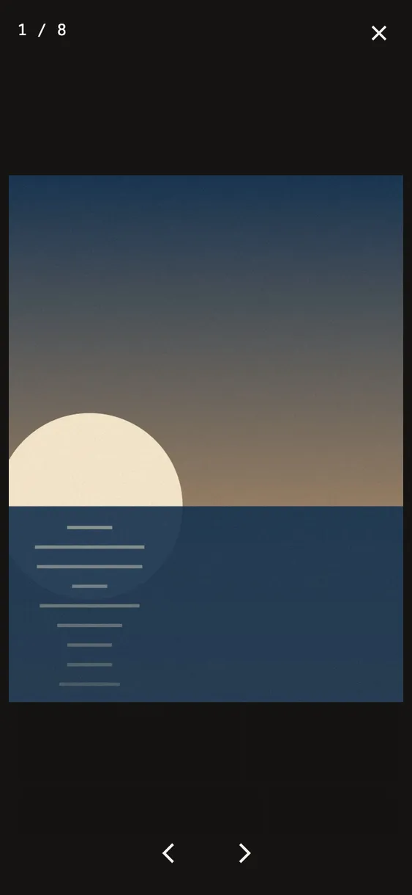
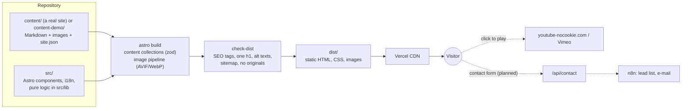

# Portfolio template

A fast, accessible, bilingual portfolio site for filmmakers, photographers and other visual artists.
Content is plain Markdown with images next to it, so the site owner can add a film or a painting without touching code.
Everything in this repository's demo is fictional. This is a portfolio project; see [License](#license).

**Live demo:** https://portfolio-template-chi-dusky.vercel.app (English) · [German](https://portfolio-template-chi-dusky.vercel.app/de/)

| Home (desktop)                                              | Work with role filter                                                 | Project page                                                                 |
| ----------------------------------------------------------- | --------------------------------------------------------------------- | ---------------------------------------------------------------------------- |
|  |  |  |

| Home (375 px)                                              | Photo series (German)                                                                    | Lightbox                                                                      |
| ---------------------------------------------------------- | ---------------------------------------------------------------------------------------- | ----------------------------------------------------------------------------- |
|  |  |  |

## Features

- **Made for people who hire:** selected work and a "Contact" action on the first screen, roles the person is looking for listed prominently, a contact link from every project that remembers which work the visitor came from.
- **Works:** films with a role filter (director, writer, editor, camera), solo projects, photo series, paintings (with an empty "coming soon" state). One folder per work, validated at build time.
- **Video without tracking:** a click-to-load player. Before the click the page shows a self-hosted thumbnail and makes no request to YouTube or Vimeo; after the click it embeds `youtube-nocookie.com` or Vimeo with do-not-track. Google Drive and other links get a clear button instead.
- **Galleries:** justified rows for photo series, a captioned grid for paintings, a lightbox built on the native `<dialog>` (keyboard, swipe, focus return).
- **Two languages:** English at `/`, German at `/de/`, a language switch on every page, `hreflang` everywhere. More languages: add one to the locale list and translate the strings.
- **Responsive images:** AVIF/WebP in several widths, lazy loading, no unprocessed originals in the build.
- **SEO:** canonical URLs, Open Graph images cropped from the film still, JSON-LD `Person`, sitemap, robots.txt; preview deployments are `noindex`.
- **Accessible:** WCAG 2.2 AA (checked with axe-core), keyboard navigation with visible focus, skip link, form errors announced to screen readers.

## Architecture



- **Static output:** every page is plain HTML built ahead of time. Nothing runs on a server for page views, so the site is fast, cheap to host and has a small attack surface.
- **Content root:** all instance data (texts, images, name, URL, e-mail) lives in one folder. The template ships `content-demo/`; a real site adds `content/`, which wins automatically (`src/config/content-root.ts`). A test fails if instance data leaks into code.
- **Pure logic apart from I/O:** URL parsing, routing helpers, the role filter mapping, form validation and JSON-LD live in `src/lib/` and `src/i18n/` without Astro imports, and are unit-tested in Node.

## Tech stack

| Area      | Choice                                                                                                    |
| --------- | --------------------------------------------------------------------------------------------------------- |
| Framework | [Astro](https://astro.build) 7, static output, content collections with zod schemas                       |
| Language  | TypeScript (strict)                                                                                       |
| Styling   | Plain CSS with design tokens (`src/styles/tokens.css`), no UI framework                                   |
| Images    | Astro image pipeline (sharp): AVIF/WebP, responsive widths                                                |
| Tests     | Vitest (unit), a post-build checker (`scripts/check-dist.mjs`), Playwright (screenshots now, E2E planned) |
| Hosting   | Vercel (static)                                                                                           |

## Quality

- Unit tests (Vitest) for the pure logic, plus a guard that keeps instance data out of the code.
- `npm run build` = type check + build + post-build checks; the build fails if a page lacks a title, description, canonical, `hreflang`, a valid Open Graph image or alt texts, or if an unprocessed original image is in the output.
- Lighthouse (local, 5 pages, mobile and desktop): 100 in Performance, Accessibility, Best Practices and SEO.
- axe-core: 0 violations on every page at 375 px and 1280 px, also with form errors shown and the lightbox open.

## How a real site is built from it

The code is shared; each site only adds its own content. A real site lives in its own **private** repository:

1. The private repository contains this code plus a `content/` folder (same structure as `content-demo/`), which replaces the demo automatically.
2. `content/site.json` holds name, URL, e-mail, city and social links; `content/profile/main/index.md` the portrait, texts, skills and the roles the person is looking for.
3. Each work is a folder in `content/projects/` with an `index.md` and its images. The schema is in `src/content.config.ts`; a missing field or a broken video link fails the build with a clear message. A painting is added by copying `content/paintings/_template/`.
4. Code updates come from this repository with one merge:

```bash
git remote add template https://github.com/morty1338/portfolio-template.git
git fetch template
git merge --allow-unrelated-histories template/main   # once
scripts/sync-template.sh                              # every later update: merge, test, build
```

Each side only writes its own content folder, so merges never touch the private content. `scripts/sync-template.sh --check` lists code that was changed in the private repository by mistake (code changes belong here).

## Project structure

```text
content-demo/          fictional demo content (a real site: content/)
  site.json            name, URL, e-mail, city, social links
  profile/main/        portrait and texts
  projects/<slug>/     one folder per work: index.md + images
  paintings/<slug>/    one folder per painting (_template/ to copy)
src/
  config/              content root, site settings, navigation
  i18n/                routing helpers and UI strings (en, de)
  lib/                 pure logic (video URLs, roles, contact form rules, JSON-LD)
  components/          header, tab bar, cards, video player, gallery, contact form, SEO
  pages/[...lang]/     every page once; empty for English, "de" for German
scripts/               dev server without cache, post-build checks, image tools, template sync
tests/unit/            Vitest
```

## Scripts

| Command                                 | What it does                                               |
| --------------------------------------- | ---------------------------------------------------------- |
| `npm run dev`                           | Development server                                         |
| `npm run build`                         | Type check, build, post-build checks                       |
| `npm run preview`                       | Serve `dist/` without caching (`scripts/serve.mjs`)        |
| `npm test`                              | Unit tests                                                 |
| `npm run images:youtube`                | Download YouTube thumbnails once, next to each project     |
| `node scripts/generate-demo-images.mjs` | Regenerate the demo images from `content-demo/images.json` |
| `node scripts/screenshots.mjs`          | Regenerate the README screenshots (after `npm run build`)  |

## Roadmap

- Contact form → signed webhook → n8n (lead list in a Google Sheet, notification, auto-reply), honeypot and rate limit
- Cookie-less analytics with custom events
- Playwright E2E tests, Lighthouse CI, GitHub Actions, Impressum/Datenschutz templates

## Credits

- Demo videos: Blender open movies, embedded from the official Blender channels: _Sintel_, _Big Buck Bunny_ and _Tears of Steel_ (CC BY 3.0), _Elephants Dream_ (CC BY 2.5), _Spring_ (CC BY 4.0), © Blender Foundation / Blender Studio. Each project page credits its film.
- Demo images are generated by `scripts/generate-demo-images.mjs`; no third-party photos are included.

## License

No license: all rights reserved. The code is public to show how it is built; it may not be copied or reused without permission.
